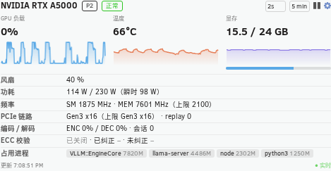

# unraid-NV-status

Real-time NVIDIA GPU monitoring tile for the Unraid dashboard — utilization, temperature,
fan, VRAM, ECC, PCIe link, encoder/decoder, power, clocks and per-process VRAM usage.

No dependencies beyond the `nvidia-driver` plugin (which provides `nvidia-smi`).
Everything runs on the host: PHP CLI sampler + nchan push + a dashboard tile.



## Features

- **Dashboard tile** with live gauges and sparklines (GPU / temp / VRAM)
- **Refresh interval 0.5 s – 10 s**, **history window 1 – 60 min** (both switchable right on
  the tile, remembered per browser; defaults set in Settings)
- **Two-tier sampling** so sub-second refresh costs almost nothing:
  - fast lane: one long-lived `nvidia-smi --query-gpu=… -lms N` stream (~1 % CPU at 0.5 s)
  - slow lane: `nvidia-smi -q -x` every N seconds for ECC / PCIe replay / process list
- **nchan push** (`/sub/nvgpu`) for <1 s latency, **automatic fallback to HTTP polling**
  when push is unavailable — the tile never goes blank
- Health flags that avoid the usual false positives:
  - PCIe "downgrade" only reported while the GPU is actually busy (idle drops to Gen1 by design)
  - ECC counters shown as `–` rather than `0` on non-ECC cards, so you never get phantom errors
- Multi-GPU aware data model (`gpus[]`), tolerant of missing fields on consumer cards

## Install

### From the Unraid UI (recommended)

Plugins → **Install Plugin** → paste:

```
https://raw.githubusercontent.com/xztjhs/unraid-NV-status/main/plugin/nvidia-gpu-status.plg
```

After install, open the Dashboard. If the tile doesn't appear, click the wrench icon
(**Tile Management**) and tick **NVIDIA GPU Status**, then Apply — that's normal Unraid
behaviour for newly installed tiles.

Settings live under **Settings → NVIDIA GPU Status**.

### Requirements

| Item | Requirement |
|---|---|
| Unraid | 7.0+ |
| Driver plugin | `nvidia-driver` (provides `/usr/bin/nvidia-smi`) |
| GPU | any NVIDIA card visible to `nvidia-smi` |

The tile renders a hint instead of failing when `nvidia-smi` is missing.

## Configuration

Everything is stored in `/boot/config/plugins/nvidia-gpu-status/nvidia-gpu-status.cfg`
and survives reboots and container/plugin upgrades.

| Key | Default | Meaning |
|---|---|---|
| `SAMPLE_MS` | `500` | Sampler poll interval (`200`–`2000`). Restarting the sampler applies it. |
| `REFRESH_MS` | `2000` | Default browser refresh (0.5–10 s) |
| `WINDOW_MIN` | `5` | Default history window (1–60 min) |
| `SLOW_SEC` | `10` | Interval for `nvidia-smi -q -x` (ECC, replay, processes) |
| `COLUMN` | `column3` | Dashboard column: `column1` / `column2` / `column3` |
| `TEMP_WARN` | `85` | Temperature warning threshold (°C) |
| `SHOW_PROCESSES` | `yes` | Show per-process VRAM usage |
| `PUSH` | `yes` | Enable nchan push |
| `ENABLED` | `yes` | Master switch (tile + sampler) |

## How it works

```
rc.nvidia-gpu-status  →  include/sampler.php  (daemon)
                           ├── nvidia-smi --query-gpu=<fast> -lms <SAMPLE_MS>   (stream)
                           └── nvidia-smi -q -x                                  (every SLOW_SEC)
                                     ↓ merge + derive health flags
                           /dev/shm/nvidia-gpu-status/latest.json   atomic write
                           /dev/shm/nvidia-gpu-status/hist.jsonl    1 Hz, last 60 min
                                     ↓
                     nchan /pub/nvgpu  ──ws──▶  browser tile
                     api.php (HTTP)    ──────▶  first paint + history + fallback
```

Measured on an RTX A5000 / Unraid 7.3.2:

| Operation | Cost |
|---|---|
| `nvidia-smi --query-gpu=<35 fields>` single shot | 88 ms |
| same with `-lms 500` (long-lived) | ~1 % CPU |
| `nvidia-smi -q -x` | 239 ms (every 10 s) |
| `api.php` (shm read) | sub-millisecond |

Sub-second refreshing via per-request `nvidia-smi` would cost ~18 % of a core at 0.5 s —
which is why the sampler is a daemon and the browser reads a tmpfs file.

## Manual operations

```bash
bash /etc/rc.d/rc.nvidia-gpu-status status     # running? latest data age?
bash /etc/rc.d/rc.nvidia-gpu-status restart    # after editing the cfg by hand
tail -f /var/log/nvidia-gpu-status.log
```

Environment self-check (also a button in Settings):

```bash
curl -s -b <cookie> "http://<tower>/plugins/nvidia-gpu-status/api.php?action=selftest"
```

## Build from source

```bash
./build.sh 2026.11.16
# → archive/nvidia-gpu-status-2026.11.16-x86_64-1.txz
# → plugin/nvidia-gpu-status.plg   (md5/sha256 injected)
```

`build.sh` validates the generated `.plg` as XML before finishing — `.plg` files are XML,
so shell operators inside `<INLINE>` must be written as entities (`&amp;&amp;`, `&lt;`).

## Layout

```
src/usr/local/emhttp/plugins/nvidia-gpu-status/
├── nvidia-gpu-status.Dashboard.page    tile registration (fills $mytiles)
├── nvidia-gpu-status.page              Settings page (Menu="Utilities")
├── api.php                             read-only JSON API
├── include/collect.php                 field parsing, normalisation, health flags
├── include/sampler.php                 daemon: two child processes + stream_select
├── include/i18n.php                    en / zh labels
├── javascript/gpu-status.js            rendering, push + polling, sparklines
├── sheets/nvidia-gpu-status.Dashboard.css
└── icons/nvidia-gpu-status.png
src/etc/rc.d/rc.nvidia-gpu-status       start|stop|restart|status
```

### Gotchas worth knowing

- **No nested `<table>`/`<tbody>` inside a tile.** Unraid's `addProperties()` calls
  `attr('title').md5()` on every `tbody` under `div.frame`; an inner one without a `title`
  throws and silently kills tile initialisation for the whole dashboard. Use divs.
- **`Menu="Utilities"` is what puts a page in Settings** (not `Menu="Settings"`), and the
  page file name becomes the URL: `nvidia-gpu-status.page` → `/Settings/nvidia-gpu-status`.
- **`/boot` is vfat — no execute bit.** Every script must be invoked as `bash <script>`.
- **POSTs need `csrf_token`**; `local_prepend.php` rejects any POST without it.
- Fields that may not exist (`ecc.errors.*` on non-ECC cards, `temperature.memory`,
  `fan.speed` on passively cooled cards) all normalise to `null` and render as `–`.

## License

MIT
