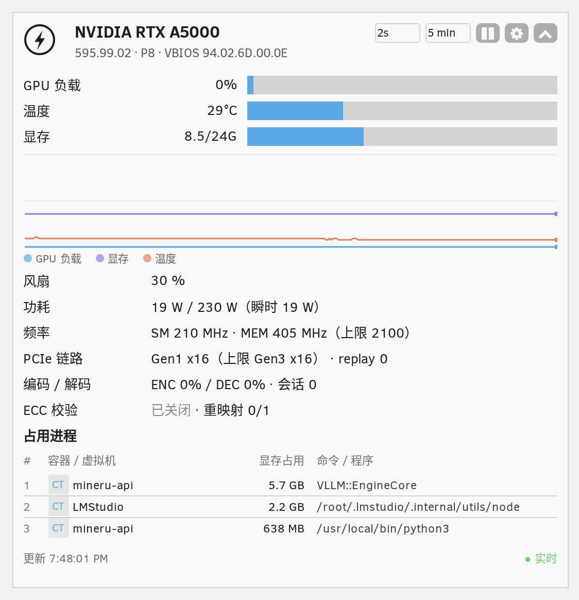

# unraid-NV-status

[English](README.md) | **简体中文**

Unraid 仪表板上的 NVIDIA GPU 实时监控磁贴 —— 利用率、温度、风扇、显存、ECC、PCIe 链路、
编解码器、功耗、频率，以及每个进程的显存占用（并标出其所属容器或虚拟机）。

除 `nvidia-driver` 插件（提供 `nvidia-smi`）外没有任何依赖。所有组件都跑在宿主机上：
PHP CLI 采样守护进程、nchan 推送通道、一个仪表板磁贴。



---

## 功能

- **视觉上是 Unraid 原生磁贴** —— 字号、行高、进度条样式都与内置的「处理器 / 内存」磁贴一致，
  不会显得像外来控件
- **三项主要指标各占一行** —— GPU 负载、温度、显存，每行一个带颜色分级的进度条
  （接近上限时由蓝转橙再转红）
- **历史折线图** 叠加 GPU / 显存 / 温度三条曲线，带图例，温度使用动态量程，
  空闲显卡的曲线不会被压成一条贴底的直线
- **进程表格** —— 序号、所属容器/虚拟机、显存占用、命令行，按显存降序排列：
  - 容器：读 `/proc/<pid>/cgroup`（`0::/docker/<id>`），与 `docker ps --no-trunc` 交叉匹配
  - 虚拟机：沿父进程链上溯到 `qemu-system`，读取其 `-name guest=<名字>`
  - 都匹配不上的标为宿主机
- **刷新间隔 0.5–10 秒**、**显示时长 1–60 分钟**，都能直接在磁贴上切换（按浏览器记忆）；
  默认值在设置页配置
- **双层采样**，让亚秒级刷新几乎不耗资源：
  - 快层 —— 一个常驻的 `nvidia-smi --query-gpu=… -lms N` 流（0.5 秒约 1% CPU）
  - 慢层 —— 每 N 秒跑一次 `nvidia-smi -q -x`，取 ECC、PCIe replay 和进程列表
- **nchan 推送**（`/sub/nvgpu`）做到亚秒级延迟，**不可用时自动降级为 HTTP 轮询**，
  磁贴永远不会空白
- **告警逻辑避开常见误报**：
  - PCIe「降速」只在 GPU 真正有负载时才报（空闲时降到 Gen1 是设计如此）
  - 非 ECC 显卡的 ECC 计数显示为 `–` 而不是 `0`，不会出现虚假的 ECC 报错
- 数据结构支持多卡（`gpus[]`），对消费级显卡缺失的字段做容错

---

## 安装

### 在 Unraid 界面里装（推荐）

插件 → **安装插件（Install Plugin）** → 粘贴：

```
https://raw.githubusercontent.com/xztjhs/unraid-NV-status/main/plugin/nvidia-gpu-status.plg
```

安装完成后打开仪表板。如果没看到磁贴，点右上角的扳手图标（**磁贴管理 / Tile Management**），
勾选 **NVIDIA GPU Status**，然后点应用 —— 新装的磁贴默认是隐藏的，这是 Unraid 的既有行为。

设置页在 **设置 → NVIDIA GPU Status**。

### 前置要求

| 项 | 要求 |
|---|---|
| Unraid | 7.0+ |
| 驱动插件 | `nvidia-driver`（提供 `/usr/bin/nvidia-smi`） |
| 显卡 | 任何 `nvidia-smi` 能识别的 NVIDIA 卡 |

`nvidia-smi` 不存在时，磁贴会显示一条提示而不是报错，采样器也拒绝启动，
不会把日志刷满。

---

## 配置

配置保存在 `/boot/config/plugins/nvidia-gpu-status/nvidia-gpu-status.cfg`，
重启与插件升级都不会丢。

| 键 | 默认值 | 含义 |
|---|---|---|
| `SAMPLE_MS` | `500` | 采样间隔（`200`–`2000` 毫秒），重启采样器后生效 |
| `REFRESH_MS` | `2000` | 浏览器默认刷新间隔（0.5–10 秒） |
| `WINDOW_MIN` | `5` | 默认显示时长（1–60 分钟） |
| `SLOW_SEC` | `10` | `nvidia-smi -q -x` 的间隔（ECC、replay、进程） |
| `COLUMN` | `column3` | 磁贴所在列：`column1` / `column2` / `column3` |
| `TEMP_WARN` | `85` | 温度告警阈值（°C） |
| `SHOW_PROCESSES` | `yes` | 是否显示进程显存表 |
| `PUSH` | `yes` | 是否启用 nchan 推送 |
| `ENABLED` | `yes` | 总开关（磁贴 + 采样器） |

磁贴上的两个下拉框只覆盖当前浏览器的 `REFRESH_MS` / `WINDOW_MIN`（存在 `localStorage`），
所以你临时调成 0.5 秒看一眼，不会影响别人的视图。

---

## 工作原理

```
rc.nvidia-gpu-status  →  include/sampler.php  (守护进程)
                           ├── nvidia-smi --query-gpu=<快层> -lms <SAMPLE_MS>   (常驻流)
                           └── nvidia-smi -q -x                                  (每 SLOW_SEC 秒)
                                     ↓ 合并 + 计算健康标记
                           /dev/shm/nvidia-gpu-status/latest.json   原子写入
                           /dev/shm/nvidia-gpu-status/hist.jsonl    每秒 1 行，保留 60 分钟
                                     ↓
                     nchan /pub/nvgpu  ──ws──▶  浏览器磁贴
                     api.php (HTTP)    ──────▶  首帧 + 历史 + 兜底
```

在 RTX A5000 / Unraid 7.3.2 / 驱动 595.99 上的实测开销：

| 操作 | 开销 |
|---|---|
| `nvidia-smi --query-gpu=<35 个字段>` 单次 | 88 毫秒 |
| 同样字段加 `-lms 500`（常驻） | 约 1% CPU |
| `nvidia-smi -q -x` | 239 毫秒（每 10 秒一次） |
| `nvidia-smi encodersessions` | **4050 毫秒** —— 因此完全不用 |
| `api.php`（读 tmpfs） | 亚毫秒级 |

如果每次请求都跑一次 `nvidia-smi` 做到 0.5 秒刷新，会吃掉约 18% 的一个核心。
这就是采样器要做成守护进程、浏览器只读 tmpfs 文件的原因。

两个值得注意的细节：

- **写入是原子的。** `latest.json` 先写临时文件再 `rename()`，读取端永远不会读到半截数据。
- **历史在服务端抽稀**到不超过 360 点。1 分钟窗口保留完整的 1 秒精度，
  60 分钟窗口抽到约 10 秒粒度，回包稳定在 30 KB 左右。

---

## 手动运维

```bash
bash /etc/rc.d/rc.nvidia-gpu-status status     # 在跑吗？最新数据多久前？
bash /etc/rc.d/rc.nvidia-gpu-status restart    # 手改配置之后
tail -f /var/log/nvidia-gpu-status.log
```

环境自检（设置页里也有对应按钮）：

```bash
curl -s -b <cookie> "http://<tower>/plugins/nvidia-gpu-status/api.php?action=selftest"
```

守护进程每 15 秒重读一次配置：改 `SAMPLE_MS` 只会重启快层子进程；
设 `ENABLED="no"` 会让它正常退出（下次安装时 `.plg` 会重新拉起）。

---

## 从源码构建

```bash
./build.sh 1.0
# → archive/nvidia-gpu-status-1.0-x86_64-1.txz
# → plugin/nvidia-gpu-status.plg   （自动注入 md5/sha256）
```

`build.sh` 会在结束前把生成的 `.plg` 当作 XML 校验一遍。这一步很关键：`.plg` 本身就是 XML，
`<INLINE>` 里的 shell 操作符必须写成实体（`&amp;&amp;`、`&lt;`）。
一个没转义的 `&&` 会产出安装时解析失败的插件。

开发时的本地安装闭环（比走界面重装快得多）：

```bash
installpkg /tmp/nvidia-gpu-status-1.0-x86_64-1.txz
bash /etc/rc.d/rc.nvidia-gpu-status restart
removepkg nvidia-gpu-status
```

---

## 目录结构

```
src/usr/local/emhttp/plugins/nvidia-gpu-status/
├── nvidia-gpu-status.Dashboard.page    磁贴注册（填充 $mytiles）
├── nvidia-gpu-status.page              设置页（Menu="Utilities"）
├── api.php                             只读 JSON API
├── include/collect.php                 字段解析、归一化、健康标记
├── include/sampler.php                 守护进程：两个子进程 + stream_select
├── include/i18n.php                    中英文案
├── javascript/gpu-status.js            渲染、推送 + 轮询、折线、进程表
├── sheets/nvidia-gpu-status.Dashboard.css
└── icons/nvidia-gpu-status.png
src/etc/rc.d/rc.nvidia-gpu-status       start|stop|restart|status
```

### 踩过坑的几条（都是真花时间的）

- **磁贴里绝对不能嵌套 `<table>`/`<tbody>`。** Unraid 的 `addProperties()` 会对 `div.frame`
  下每一个 `tbody` 执行 `attr('title').md5()`。内层 tbody 没有 `title` 就会抛异常，
  而这个异常会静默中断**整个仪表板**的磁贴初始化 —— 所有磁贴一起消失，不只是你的。
  全部用 `<div>`。
- **让页面进设置菜单的是 `Menu="Utilities"`**，不是 `Menu="Settings"`。页面文件名就是 URL：
  `nvidia-gpu-status.page` → `/Settings/nvidia-gpu-status`。
- **`/boot` 是 vfat，没有可执行位。** 所有脚本都必须用 `bash <脚本>` 调用；
  在那里 `chmod +x` 是空操作。
- **POST 必须带 `csrf_token`。** `local_prepend.php` 会拒掉所有不带它的 POST，
  包括你自己的 AJAX 端点。
- **`pkill -f <脚本名>` 会匹配到自己这条 SSH 命令**并把连接打断。
  用 `pgrep -af '[p]attern'` 或按 PID 杀。
- 可能不存在的字段（非 ECC 卡的 `ecc.errors.*`、`temperature.memory`、
  被动散热卡的 `fan.speed`）统一归一化成 `null`，显示为 `–`。
  本插件从不把「不支持」当成「零」。

---

## 版本约定

发布用 `vX.Y` 打标签。`.plg` 里的 `version` 属性、txz 文件名、
`/boot/config/plugins/nvidia-gpu-status/version` 三处必须一致 ——
否则 Unraid 的更新检查判断不出有新版本。

## 许可证

MIT
